<p align="center"></p>

<h1 align="center">panelviz</h1>

<p align="center">An R package for visualising any panel data: say which column is the individual and which is time, and get publication-ready charts.</p>

> **Preview — v0.0.1.** Works and is tested on eight public panels, but the API may still change; see [Known issues](#known-issues-v001). Feedback welcome via GitHub issues.

## Why

Panel data (the same people, firms or countries observed again and again over time) is everywhere, and every analysis
repeats the same chores: decode whatever the time column looks like, reshape, collapse time per individual, collapse
individuals into groups, then fight a plotting library until the chart is fit to publish. Each step is easy to get
subtly wrong, such as summing a stock instead of taking its last value, or averaging over groups of three people.

We built these chores once for weekly Viva Insights person data, in [`wpa`](https://github.com/microsoft/wpa) and
[`vivainsights`](https://github.com/microsoft/vivainsights), and found the plots reusable far beyond that data.
panelviz is that machinery for any panel: you say what the individual is and what time is, and everything else is a
default you can override.

Panel data goes by other names depending on the field: *longitudinal data* or *repeated measures* in medicine,
psychology and epidemiology; *time-series cross-section* in political science; *cross-sectional time series* in
Stata; *multilevel* or *growth-curve* data in the social sciences; *grouped* or *hierarchical time series* in
forecasting. The individual may be a subject, unit, entity, participant, person, firm or country, and time may be a
wave, occasion, visit, period or year. If your data is one row per individual and moment, panelviz is for you.

## What

```r
library(panelviz)
nls <- read_panel("https://www.stata-press.com/data/r18/nlswork.dta", id = idcode, time = year)

nls
#> # A tidy panel: 4,711 individuals x 15 periods (year),  1968-01-01 to 1988-01-01
#> # id = idcode | time = year | unbalanced (40% of id-period cells filled) | 28,534 obs

panel_line(nls, "ln_wage", by = "race")
```

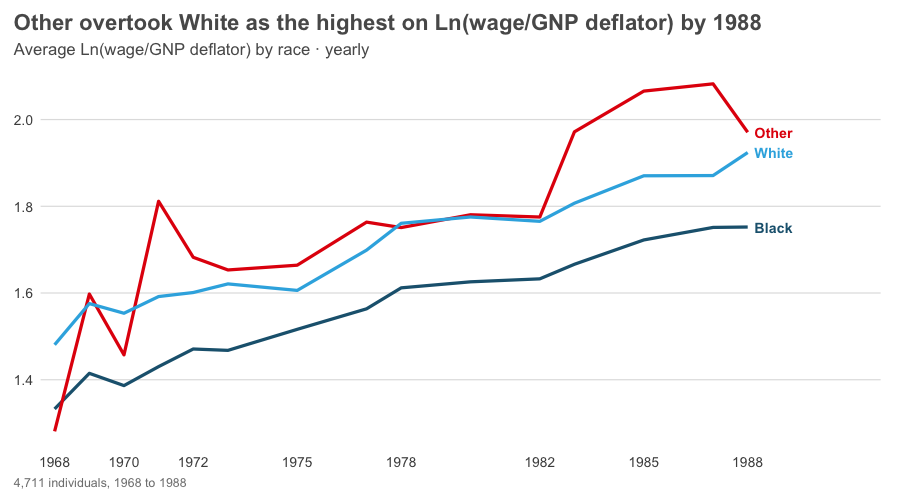

You get a tidy panel object, a two-stage aggregation you control with `period`, `fun_time` and `fun_group`, and a set of
charts that share the same arguments. Titles say what the data shows, subtitles say what was calculated, and the
default look follows The Economist's charts.

| Function | What it's for |
|---|---|
| `read_panel()`, `as_panel()`, `as_panel_wide()` | Declare the individual and time; read csv, tsv, Stata, SPSS or rds files, from a path or a URL. |
| `panel_aggregate()` | The two-stage aggregation on its own, returned as a table. |
| `panel_line()` | One line per group, labelled directly; highlight, index to 100, log scale, small multiples. |
| `panel_heatmap()` | Groups (or individuals) by time. |
| `panel_spaghetti()` | Individual trajectories with the group average on top. |
| `panel_tracking()` | A series with its rolling average. |
| `panel_band()` | Median with a percentile band across individuals. |
| `panel_bar()`, `panel_stacked()` | Ranked or composed groups, with group sizes in the subtitle. |
| `panel_distribution()` | How individuals are distributed. |
| `panel_figure()`, `save_panel()` | Numbered multi-panel figures with a shared source footer; save any chart. |
| `panel_plot(kind = )` | Any of the charts, chosen by name. |
| `panel_styles()`, `use_panel_style()` | `economist` (default), `ft`, `clean`, `dark`, `mono`. |

## How

Why it stays small and predictable:

- **Time is detected, not configured.** Dates, hourly timestamps, years, two-digit years, `"1998 Q1"`, `"2020-03"`,
  ISO weeks, `yyyymm`, text dates, Stata `%tm/%tq/%ty` and plain indices all work. Ambiguous dates and repeated
  id-time rows stop with a message instead of guessing.
- **Aggregation has two stages, because panels have two dimensions.** First within each individual over time
  (`fun_time`: `sum` for flows, `last` for stocks), then across individuals into groups (`fun_group`: `mean`, `median`,
  `p90`, any function). `min_n` hides thin groups and the footer says so.
- **One set of arguments for every chart.** `by`, `period`, `fun_time`, `fun_group`, `min_n`, `tag`, `source`, `style`
  and `return = "table"` mean the same everywhere, so learning one chart teaches the rest.
- **Text is computed from the data.** The headline reports what moved, who leads or who overtook whom; the subtitle
  says what was calculated; Stata variable labels become names. Override any of it with `title` and `subtitle`.
- **Axes pick their own units** (`950`, `1.2K`, `6M`), detect percentages, and show the year only where it changes.
- **Fonts degrade gracefully.** The best condensed face found is used (`panel_font()`); a device that cannot use it
  gets a clean redraw with its default font.

## Tested on

| Dataset | Individual and time |
|---|---|
| Stata `nlswork` | numeric id, two-digit years, unbalanced |
| Stata `grunfeld`, `abdata` | company or firm id, year |
| Stata `reshape1` | wide: `inc80 inc81 ...`, `ue80 ue81 ...` |
| `Gasoline`, `Fatalities` (Rdatasets) | country or state id, year |
| `tourism` (Rdatasets) | composite id of region, state and purpose; `1998 Q1` quarters |
| Gapminder | country, 5-year steps |
| COVID-19 daily counts | 198 countries, ISO dates, 816 days |
| `wpa` sample data | hashed person id, text dates `12/15/2019` |

See `data-raw/fetch.R` and `data-raw/check_examples.R` to reproduce.

## Installation

```r
# install.packages("remotes")
remotes::install_github("moralec/panelviz")
```

Needs R 4.1 or later. `haven` is used for Stata and SPSS files, `readr` for csv, `systemfonts` and `ragg` for the
best fonts; all optional.

## Examples

<!-- examples:start (generated by data-raw/readme_examples.R) -->

Every command below is the one that produced the output next to it. First, the data:

```r
library(panelviz)

# Stata dta, text csv and daily csv, straight from the web: id = who, time = when
nls   <- read_panel("https://www.stata-press.com/data/r18/nlswork.dta",
                    id = idcode, time = year, source = "US Bureau of Labor Statistics, NLS of Young Women")
gm    <- read_panel("https://raw.githubusercontent.com/plotly/datasets/master/gapminderDataFiveYear.csv",
                    id = country, time = year, source = "Gapminder")
tour  <- read_panel("https://vincentarelbundock.github.io/Rdatasets/csv/tsibble/tourism.csv",
                    id = c(Region, State, Purpose), time = Quarter, source = "Tourism Research Australia")
covid <- read_panel("https://raw.githubusercontent.com/datasets/covid-19/main/data/countries-aggregated.csv",
                    id = Country, time = Date, source = "Johns Hopkins CSSE")
gf    <- read_panel("https://www.stata-press.com/data/r18/grunfeld.dta",
                    id = company, time = year, source = "Grunfeld (1958)")
```

### Declare the panel

Say which column is the individual and which is time. panelviz recognises the time format, sorts the data and reports its shape: 4,711 women observed in 15 survey years, unbalanced because not everyone answered every year.

- `id`: one column, or several for a composite key (`c(Region, State, Purpose)`)
- `time`: the time column, in almost any format
- `source`: printed as "Source: ..." in every chart footer

```r
print(nls, n = 3)
```

```
# A tidy panel: 4,711 individuals x 15 periods (year), 1968-01-01 to 1988-01-01
# id = idcode | time = year | unbalanced (40% of id-period cells filled) | 28,534 obs
# A tibble: 28,534 × 23
  .id   .time      idcode  year birth_yr   age race       msp nev_mar grade collgrad not_smsa c_city
* <chr> <date>      <dbl> <dbl>    <dbl> <dbl> <dbl+lb> <dbl>   <dbl> <dbl>    <dbl>    <dbl>  <dbl>
1 1     1970-01-01      1    70       51    18 2 [Blac…     0       1    12        0        0      1
2 1     1971-01-01      1    71       51    19 2 [Blac…     1       0    12        0        0      1
3 1     1972-01-01      1    72       51    20 2 [Blac…     1       0    12        0        0      1
# ℹ 28,531 more rows
# ℹ 10 more variables: south <dbl>, ind_code <dbl>, occ_code <dbl>, union <dbl>, wks_ue <dbl>,
#   ttl_exp <dbl>, tenure <dbl>, hours <dbl>, wks_work <dbl>, ln_wage <dbl>
```

### Time formats are detected

The same call handles quarters, ISO weeks, US-style dates, `yyyymm` numbers and hourly timestamps. Ambiguous input (`01/02/2020`) stops with a message instead of guessing; pass `time_format` to choose.

- `time_format`: `NULL` (detect), a `strptime()` string such as `"%d.%m.%Y"`, or `"year"`, `"quarter"`, `"month"`, `"week"`, `"index"`

```r
what <- list(quarters = c("1998 Q1", "1998 Q2"), iso_weeks = c("2020-W01", "2020-W02"),
             us_dates = c("12/15/2019", "12/22/2019"), yyyymm = c(202001, 202002),
             hourly = c("2024-03-01 00:00:00", "2024-03-01 01:00:00"), two_digit_years = c(68, 69))
sapply(what, function(x) unlist(panel_meta(as_panel(data.frame(id = 1, t = x), id, t))[c("kind", "freq")]))
```

```
     quarters  iso_weeks us_dates yyyymm  hourly two_digit_years
kind "quarter" "week"    "date"   "month" "hour" "year"         
freq "quarter" "week"    "week"   "month" "hour" "year"         
```

### Wide data

One column per period (and per measure) is pivoted to long format first. Here Stata's `reshape1` has `inc80 inc81 inc82` and `ue80 ue81 ue82`.

- `cols`: the period columns (tidyselect)
- `names_pattern`: regular expression with two groups, measure then period; `NULL` when the column names are the periods

```r
wide <- as_panel_wide(haven::read_dta("https://www.stata-press.com/data/r18/reshape1.dta"),
                       id, cols = c(starts_with("inc"), starts_with("ue")),
                       names_pattern = "^(inc|ue)(\\d+)$")
wide
```

```
# A tidy panel: 3 individuals x 3 periods (year), 1980-01-01 to 1982-01-01
# id = id | time = period | balanced | 9 obs
# A tibble: 9 × 7
  .id   .time         id   sex period   inc    ue
* <chr> <date>     <dbl> <dbl> <chr>  <dbl> <dbl>
1 1     1980-01-01     1     0 80      5000     0
2 1     1981-01-01     1     0 81      5500     1
3 1     1982-01-01     1     0 82      6000     0
4 2     1980-01-01     2     1 80      2000     1
5 2     1981-01-01     2     1 81      2200     0
6 2     1982-01-01     2     1 82      3300     0
7 3     1980-01-01     3     0 80      3000     0
8 3     1981-01-01     3     0 81      2000     0
9 3     1982-01-01     3     0 82      1000     1
```

### Aggregate in two stages

Panel data has two dimensions, so aggregation has two stages. First, within each individual, time is collapsed into `period` (`fun_time`). Then individuals are collapsed into groups (`fun_group`). Here: each tourism flow's yearly *total* trips, then the *mean* across flows in each state. `.n` is the number of individuals behind each value.

- `vars`: numeric columns to summarise (default all)
- `by`: grouping column(s); `NULL` for one overall series; `".id"` keeps individuals
- `period`: `"hour"`, `"day"`, `"week"`, `"month"`, `"quarter"`, `"year"` or `"all"`
- `fun_time`, `fun_group`: `mean median sum sd min max first last n share p10 p90 ...` or any function
- `min_n`: drop group-periods with fewer individuals

```r
panel_aggregate(tour, "Trips", by = "State", period = "year", fun_time = "sum", fun_group = "mean")
```

```
# A tibble: 160 × 4
   .period    State Trips    .n
   <date>     <chr> <dbl> <int>
 1 1998-01-01 ACT    463.     4
 2 1999-01-01 ACT    495.     4
 3 2000-01-01 ACT    523.     4
 4 2001-01-01 ACT    522.     4
 5 2002-01-01 ACT    493.     4
 6 2003-01-01 ACT    486.     4
 7 2004-01-01 ACT    470.     4
 8 2005-01-01 ACT    497.     4
 9 2006-01-01 ACT    473.     4
10 2007-01-01 ACT    489.     4
# ℹ 150 more rows
```

### Line: one overall series

The title is computed from the data. Axes use the best units, and the year appears only where it changes.

- `var`: the variable to plot

```r
panel_line(nls, "ln_wage")
```

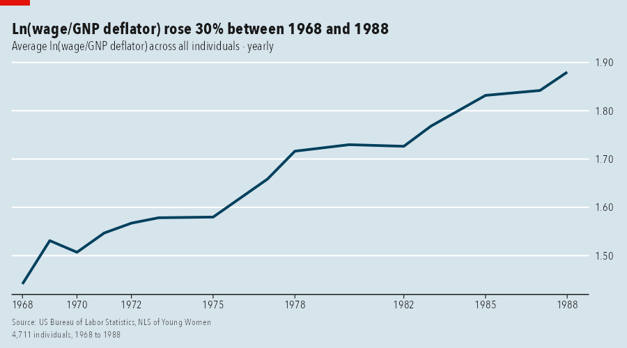

### Line: one line per group

Lines are labelled directly. When the leader changes, the headline says who overtook whom.

- `by`: the grouping column
- `max_groups`: keep the largest groups (default 10)

```r
panel_line(gm, "lifeExp", by = "continent")
```

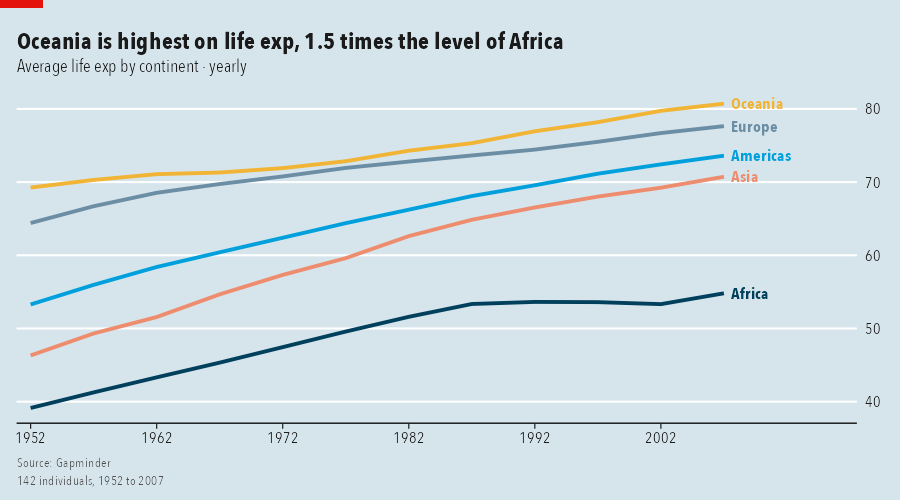

### Line: highlight one group, index to 100

Grey out everything except what you want the reader to look at, and rebase every group so its first period equals 100.

- `highlight`: group name(s) to emphasise
- `index`: `TRUE` rebases each group to 100 at its first period

```r
panel_line(gf, "invest", by = "company", highlight = "1", index = TRUE)
```

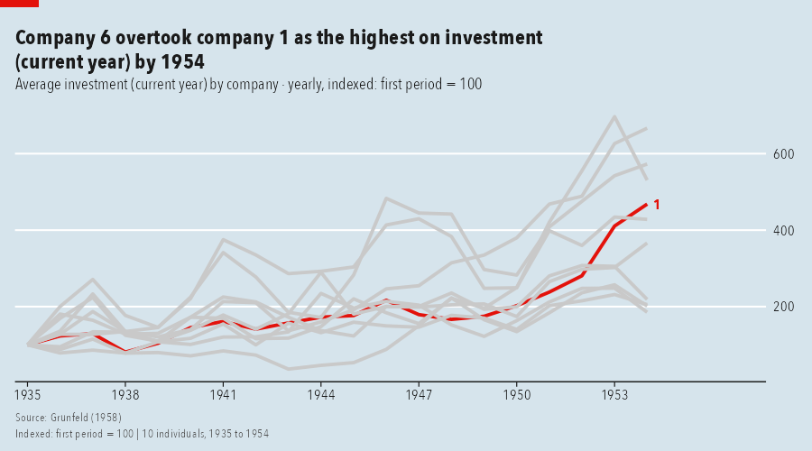

### Coarsen time: quarters to years

`period` changes the time unit, and `fun_time` says how each individual's quarters combine: here the yearly total of each tourism flow, averaged by state.

- `period = "year"`
- `fun_time = "sum"`: flows add up; use `"last"` for stocks and cumulative counts

```r
panel_line(tour, "Trips", by = "State", period = "year", fun_time = "sum")
```

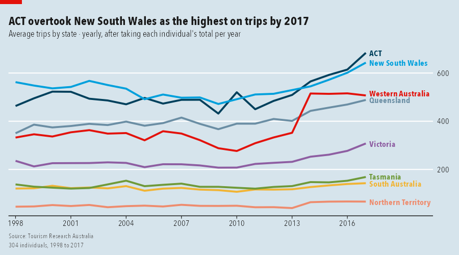

### A different summary, and a privacy floor

Show the 90th percentile instead of the mean, and hide any state-year with fewer than 30 individuals. The footer says groups were hidden.

- `fun_group = "p90"`
- `min_n = 30`

```r
panel_line(tour, "Trips", by = "State", period = "year", fun_group = "p90", min_n = 30)
```

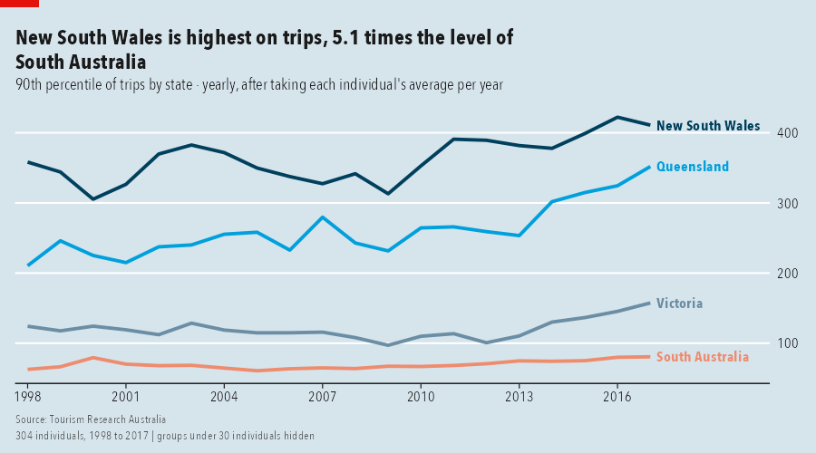

### Small multiples and a log scale

One panel per group with free y axes; `log = TRUE` is useful when groups differ by orders of magnitude.

- `facet = TRUE`
- `log = TRUE`

```r
panel_line(gm, "gdpPercap", by = "continent", facet = TRUE, log = TRUE)
```

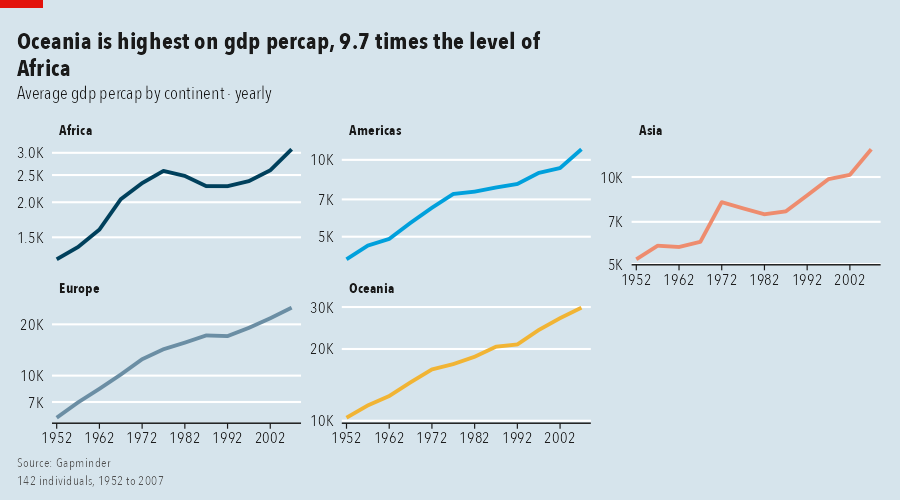

### Heatmap: groups by time

Rows are groups, columns are periods, colour is the value. Rows are sorted by level. With `by = NULL` the rows are individuals.

- `by`, `period`, `fun_time`, `fun_group` as above
- `max_rows`: rows shown when rows are individuals (default 40)

```r
panel_heatmap(tour, "Trips", by = "State", period = "year")
```

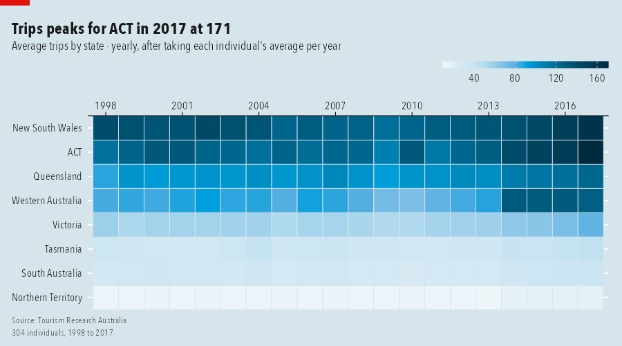

### Heatmap of individuals, diverging colours

With `by = NULL` every row is one individual (here 30 of 142 countries, evenly spaced by level). `diverge` centres the colour scale on the overall mean, so blue is below average and red above.

- `by = NULL`: rows are individuals
- `max_rows`: how many rows to show
- `diverge = TRUE`

```r
panel_heatmap(gm, "lifeExp", max_rows = 30, diverge = TRUE)
```

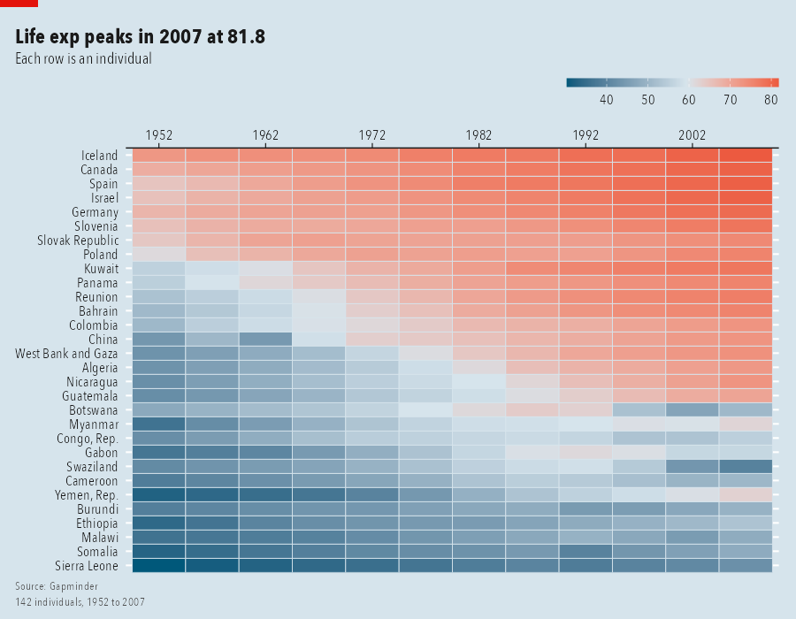

### Spaghetti: individuals and the average

Thin lines are individuals, the bold line is the group summary. A log axis keeps small firms visible next to large ones.

- `n_ids`: how many individual lines to draw (random sample, reproducible with `seed`)
- `log = TRUE`

```r
panel_spaghetti(gf, "invest", log = TRUE)
```

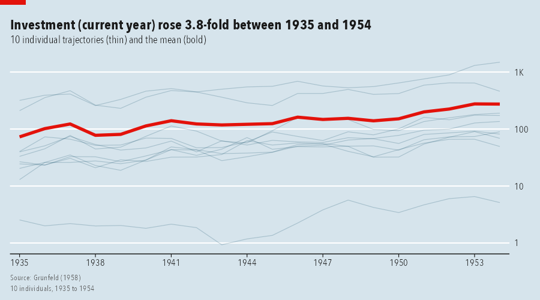

### Tracking: a series and its rolling average

Cumulative counts per country become a weekly series: each country's last value of the week, summed across countries, with a 4-week rolling average.

- `window`: periods in the rolling average
- `fun_time = "last"`, `fun_group = "sum"`

```r
panel_tracking(covid, "Confirmed", period = "week", fun_time = "last", fun_group = "sum", window = 4)
```

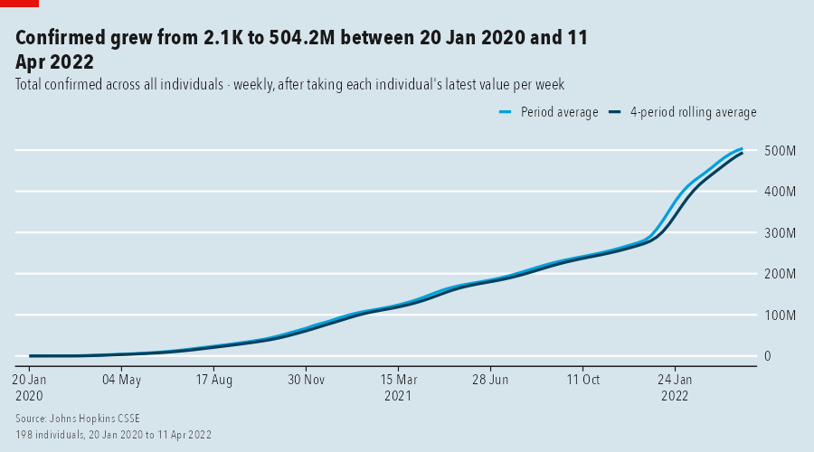

### Band: the spread across individuals

The median line with a shaded percentile band shows spread, not just the centre. The headline reports whether the spread widened.

- `lower`, `upper`: band edges (`"p10"`, `"p90"`, ...)
- `centre`: line summary (default `"median"`)

```r
panel_band(nls, "ln_wage", by = "race", lower = "p10", upper = "p90")
```

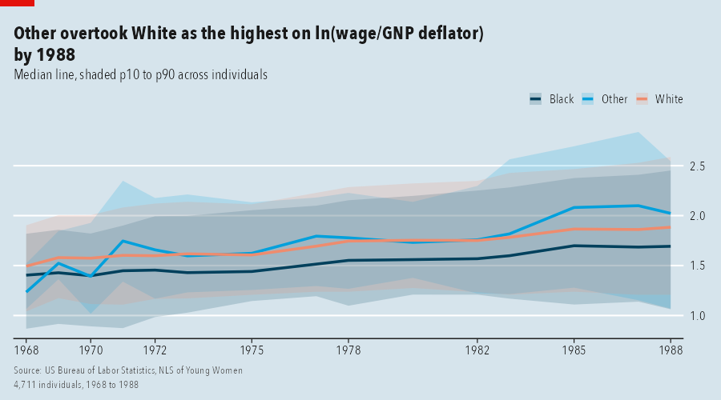

### Bars: ranked groups

Time is collapsed (`period = "all"`). Names sit inside long bars; group sizes are in the subtitle.

- `top_n`: groups shown (default 15)
- `decreasing`: sort order

```r
panel_bar(tour, "Trips", by = "State")
```

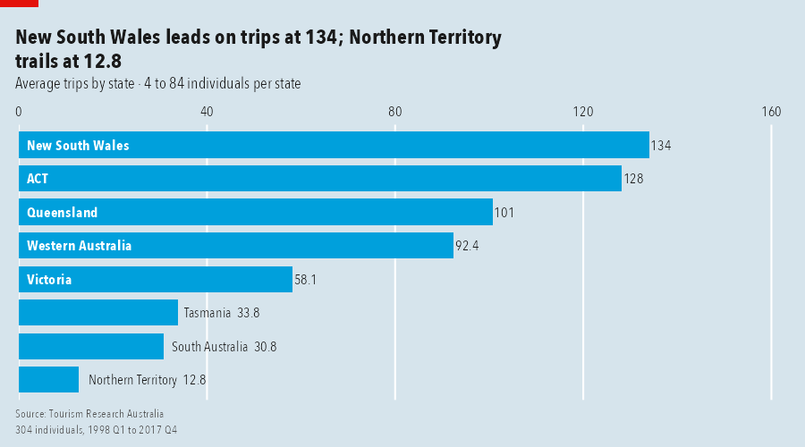

### Stacked bars: composition

Several measures stacked within each group. Segment labels that would not fit are hidden.

- `vars`: two or more columns
- `min_label`: smallest share of the longest bar that gets a label

```r
panel_stacked(gf, c("invest", "kstock"), by = "company", top_n = 6)
```

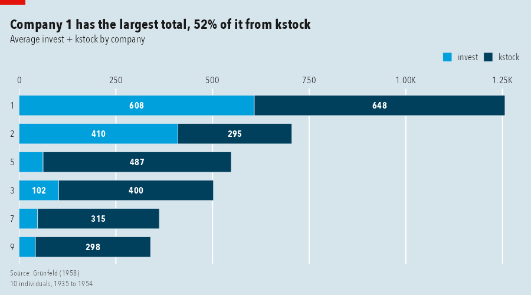

### Distribution of individuals

Each individual's average over time, then the distribution across individuals, by group.

- `period = "all"`, `fun_time = "mean"`

```r
panel_distribution(nls, "ln_wage", by = "race")
```

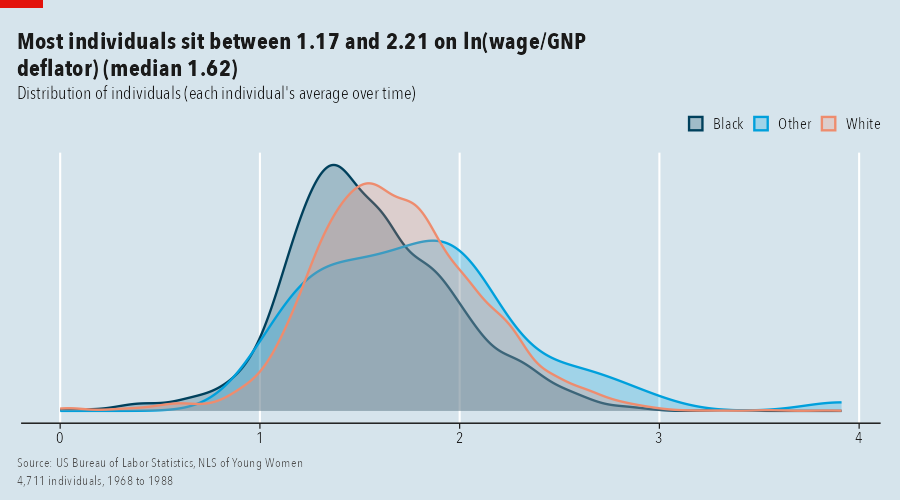

### Style, tag, title and source

Five looks ship with the package: `economist` (default), `ft`, `clean`, `dark`, `mono`. Any computed text can be overridden. The numbered square is for figure references.

- `style`: one of `panel_styles()` (or `use_panel_style("ft")` for the session)
- `tag`: number or label in the top-right square
- `title`, `subtitle`, `source`

```r
panel_bar(tour, "Trips", by = "State", style = "ft", tag = 2,
          title = "New South Wales and Victoria dominate", source = "Tourism Research Australia, 1998-2017")
```

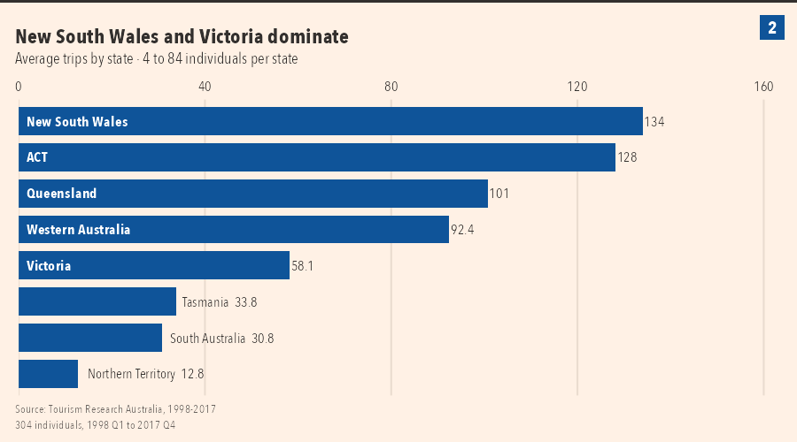

### Numbered figure from several charts

`panel_figure()` lays charts out under one headline, numbers the panels and shares one source and notes footer.

- `ncol`, `heights`, `widths`: layout
- `title`, `subtitle`, `source`, `notes`: shared text
- `tags = TRUE`: number the panels

```r
fig <- panel_figure(
  list(panel_line(gm, "lifeExp", by = "continent"),
       panel_bar(tour, "Trips", by = "State"),
       panel_band(nls, "ln_wage", by = "race", lower = "p10", upper = "p90"),
       panel_heatmap(tour, "Trips", by = "Purpose")),
  title = "Four views, one grammar", subtitle = "The same panelviz calls on three different panels",
  source = "Gapminder; Tourism Research Australia; US Bureau of Labor Statistics",
  notes = "Individuals are countries, tourism flows and women respectively.")
save_panel(fig, "figure.png", width = 14, height = 9)
```

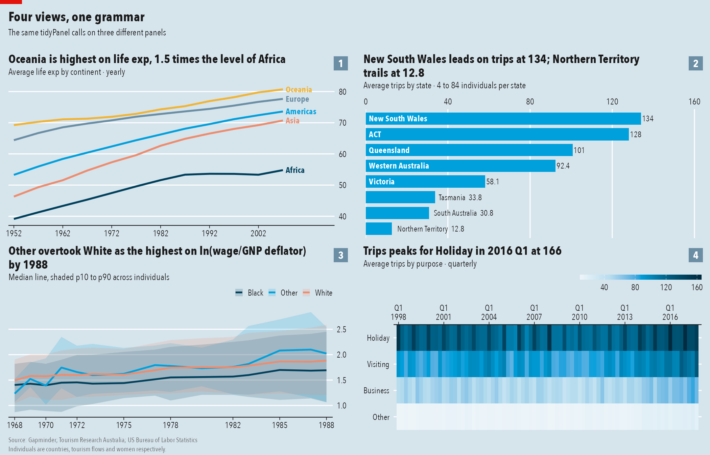

### Get the numbers behind any chart

Every chart takes `return = "table"` and hands back exactly what it drew.

- `return = "table"`

```r
panel_line(gm, "lifeExp", by = "continent", return = "table")
```

```
# A tibble: 60 × 5
   .period    continent lifeExp    .n .group
   <date>     <chr>       <dbl> <int> <chr> 
 1 1952-01-01 Africa       39.1    52 Africa
 2 1957-01-01 Africa       41.3    52 Africa
 3 1962-01-01 Africa       43.3    52 Africa
 4 1967-01-01 Africa       45.3    52 Africa
 5 1972-01-01 Africa       47.5    52 Africa
 6 1977-01-01 Africa       49.6    52 Africa
 7 1982-01-01 Africa       51.6    52 Africa
 8 1987-01-01 Africa       53.3    52 Africa
 9 1992-01-01 Africa       53.6    52 Africa
10 1997-01-01 Africa       53.6    52 Africa
# ℹ 50 more rows
```

<!-- examples:end -->

> **Not to be confused with [panelView](https://cran.r-project.org/package=panelView)** on CRAN, which plots treatment
> status and outcomes for causal-inference panels. panelviz is a general toolkit: import, aggregate and chart any panel.

## Known issues (v0.0.1)

1. Not on CRAN yet.
2. Stata `%tw` weeks are read approximately.
3. Wide data with several measures needs a `names_pattern`; there is no automatic guess.
4. The red tag and numbered squares are drawn when a chart is printed or saved, so they are lost if a chart is placed
   inside patchwork or cowplot; use `panel_figure()` instead.
5. Group names in direct line labels can still overlap when many series end at nearly the same value.
6. Only R for now.

## Licence

MIT. Generalises the plotting approach of `wpa` and `vivainsights` (Microsoft, MIT).
