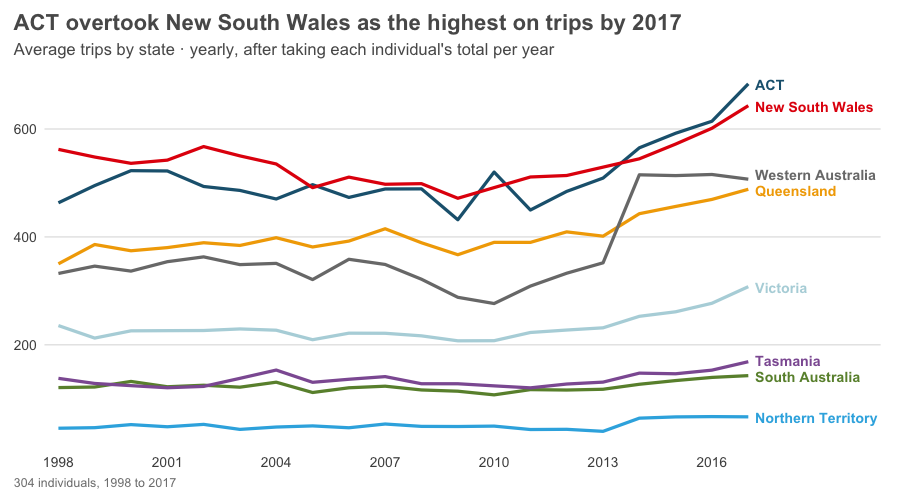
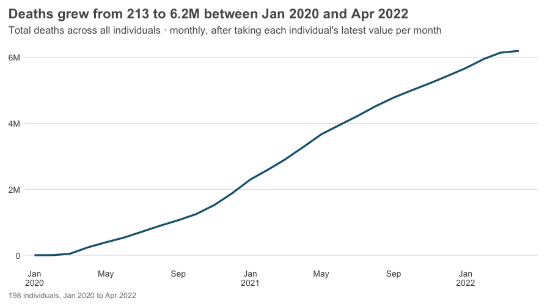
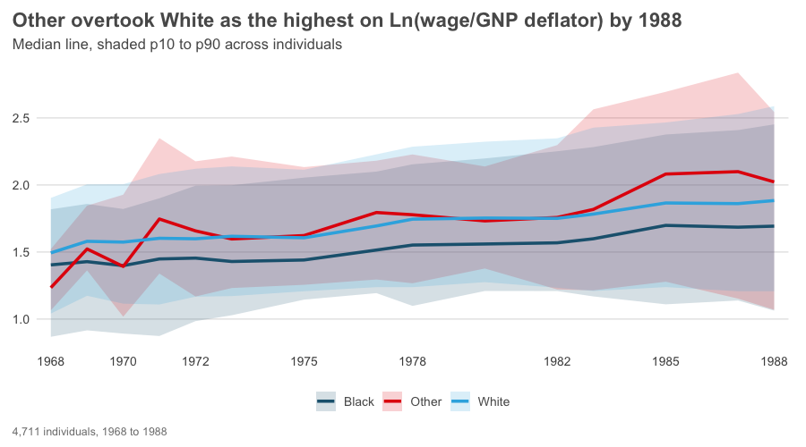
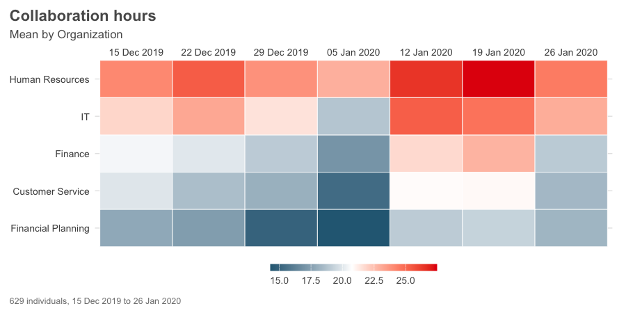

# tidyPanel

Tell it which column is the **individual** and which is **time**. It recognises the
formats, organises the data, aggregates in two stages, and plots.

```r
# remotes::install_github("moralec/tidyPanel")
library(tidyPanel)

p <- read_panel("nlswork.dta", id = idcode, time = year)   # or as_panel(df, id, time)
p
#> # A tidy panel: 4,711 individuals x 15 periods (year), 1968-01-01 to 1988-01-01
#> # id = idcode | time = year | unbalanced (40% of id-period cells filled) | 28,534 obs

panel_line(p, "ln_wage", by = "race")
```


## Import: many shapes of panel

| Time looks like | Detected as |
|---|---|
| `Date`, `POSIXct`, `"2019-12-15"`, `"12/15/2019"`, `20200131` | day / week / month (by spacing) |
| hourly or minute timestamps | hour, or irregular (give a `period` to aggregate) |
| `1998`, `68` (two-digit), `"1998 Q1"`, `"2020-03"`, `202003`, `"2020-W07"`, `"Jan 2020"` | year / quarter / month / week |
| Stata `%tm`, `%tq`, `%ty` | month / quarter / year |
| plain integers `1, 2, 3` | index |

* **Composite ids**: `id = c(region, product)`.
* **Wide data**: `as_panel_wide(df, id, cols = starts_with("inc"), names_pattern = "^(inc|ue)(\\d+)$")`.
* **Files and URLs**: `read_panel()` reads csv, tsv, `.dta`, `.sav`, `.rds`.
* Ambiguous dates (`01/02/2020`) and repeated id-time rows stop with a message instead of guessing.

## Aggregate: the key idea

Panel data has two dimensions, so aggregation has two stages:

1. **within each individual**, collapse time into a `period` (`fun_time`);
2. **across individuals**, collapse them into groups (`fun_group`), with `min_n` as a privacy floor.

```r
panel_line(p, "Trips", by = "State", period = "year", fun_time = "sum")
# each series' yearly total per tourism flow, then the mean across flows in the state
panel_aggregate(p, "Trips", by = "State", period = "quarter", fun_group = "p90", min_n = 5)
```



Summaries by name (`mean median sum sd min max first last n share p10`...) or any function.
`period` can be `hour day week month quarter year` or `"all"`.

## Smart axes and titles

* **Axes** switch units by themselves (`950`, `1.2K`, `6M`) with one precision per axis; rates and shares are
  shown as percentages; dates show the year only where it changes (`Nov` `Dec` `Jan 2021`).
* **Headlines are computed from the plotted data**: *"Other overtook White as the highest on ln(wage/GNP deflator) by 1988"*,
  *"Deaths grew from 213 to 6.2M between Jan 2020 and Apr 2022"*, *"Trips peaks for Holiday in 2016 Q1 at 166"*.
* **Subtitles say what was calculated**: *"Total deaths across all individuals · monthly, after taking each individual's latest value per month"*.
* Stata/SPSS **variable labels** are used as names; the caption discloses hidden groups (`min_n`).
* Override with `title =` / `subtitle =`, or `options(tidyPanel.smart_titles = FALSE)` for plain variable names.



## Charts

All share `by`, `period`, `fun_time`, `fun_group`, `min_n`, and `return = "table"`.

| Function | Shows |
|---|---|
| `panel_line()` | one line per group, direct labels; `highlight=`, `index=`, `log=`, `facet=` |
| `panel_heatmap()` | groups (or individuals) by time |
| `panel_spaghetti()` | individual trajectories with the group average on top |
| `panel_tracking()` | period average and a rolling average |
| `panel_band()` | median with a percentile band across individuals |
| `panel_bar()` / `panel_stacked()` | ranked or composed groups, with `n=` in the labels |
| `panel_distribution()` | distribution of individuals |
| `panel_plot(kind = )` | any of the above by name |

 

## Tested on

Stata's `nlswork`, `grunfeld`, `abdata` and `reshape1` (wide); Rdatasets `Gasoline`, `Fatalities`,
`tourism` (quarterly, composite id); Gapminder (5-year steps); daily COVID-19 counts for 198 countries;
Viva Insights weekly person data (text dates). See `data-raw/fetch.R` and `data-raw/check_examples.R`.

## Origin and roadmap

Generalises the plotting approach of [`wpa`](https://github.com/microsoft/wpa) and
[`vivainsights`](https://github.com/microsoft/vivainsights). The plan is for both to depend on
tidyPanel and keep their `create_*` functions as thin wrappers.

MIT licence.
