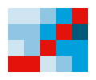

<p align="center"></p>

<h1 align="center">panelviz</h1>

<p align="center">An R package for visualising any panel (longitudinal) data: say which column is the individual and which is time, and get publication-ready charts.</p>

## Overview

panelviz is an R package for visualising any panel (longitudinal) data. Given the column that identifies the
individual and the column that records time, it recognises the time format, aggregates the data over time and across
individuals, and draws publication-ready charts. It provides a consistent set of functions for each stage:

- `read_panel()`, `as_panel()` and `as_panel_wide()` declare a data frame, file or URL as a panel (csv, tsv, Stata, SPSS, rds).
- `panel_aggregate()` aggregates in two stages: within each individual over time, then across individuals by group.
- `panel_line()`, `panel_heatmap()`, `panel_spaghetti()`, `panel_tracking()`, `panel_band()`, `panel_bar()`,
  `panel_stacked()` and `panel_distribution()` draw the data. All share the same arguments.
- `panel_figure()` and `save_panel()` compose numbered multi-panel figures and save any chart.
- `panel_styles()` and `use_panel_style()` select one of five looks: `economist` (the default), `ft`, `clean`, `dark` and `mono`.

```r
library(panelviz)
nls <- read_panel("https://www.stata-press.com/data/r18/nlswork.dta", id = idcode, time = year)

nls
#> # A tidy panel: 4,711 individuals x 15 periods (year), 1968-01-01 to 1988-01-01
#> # id = idcode | time = year | unbalanced (40% of id-period cells filled) | 28,534 obs

panel_line(nls, "ln_wage", by = "race")
```


## Why

Panel data consists of repeated observations of the same individuals over time, stored in long format with one row per
individual and time point. It arises in economics and business (firms, households, markets), public health and
epidemiology (patients, clinic visits, countries), education and psychology (pupils, terms, study sessions), tourism
and retail (regions, stores, quarters) and organisational analytics (employees, weeks). Terminology differs by
discipline: *panel data* in economics, *longitudinal data* or *repeated measures* in medicine and psychology,
*time-series cross-section* in political science, and *grouped* or *hierarchical time series* in forecasting. The
individual may be called a subject, unit, entity or participant, and time a wave, occasion, visit or period.

Analysing such data involves a recurring sequence of steps: identifying the individual and time variables and parsing
the time format, aggregating over time within each individual, aggregating across individuals into groups, and
presenting the result in a form suitable for publication. Errors tend to arise at the aggregation steps, for example
summing a stock variable where its last value is meant, or reporting a statistic for a group too small to be
meaningful.

panelviz implements this sequence behind a single declaration of the individual and time variables. It originates in
the plotting functions of [`wpa`](https://github.com/microsoft/wpa) and
[`vivainsights`](https://github.com/microsoft/vivainsights), which were developed for weekly Viva Insights
person-level data, and generalises them to any panel.

## How

- **Time formats are detected.** Dates, hourly timestamps, years, two-digit years, `"1998 Q1"`, `"2020-03"`, ISO weeks,
  `yyyymm`, text dates, Stata `%tm`, `%tq` and `%ty` values and plain indices are supported. Ambiguous dates and
  repeated id-time rows stop with an informative error instead of being guessed.
- **Aggregation has two stages, because a panel has two dimensions.** Time is collapsed within each individual first
  (`fun_time`: `sum` for flows, `last` for stocks), then individuals are collapsed into groups (`fun_group`: `mean`,
  `median`, `p90` or any function). `min_n` suppresses groups with too few individuals, and the chart footer reports it.
- **Every chart takes the same arguments.** `by`, `period`, `fun_time`, `fun_group`, `min_n`, `tag`, `source`, `style` and
  `return = "table"` have the same meaning in each function.
- **Text is derived from the data.** The title reports what changed, which group leads or which overtook another; the
  subtitle states what was calculated; Stata variable labels are used as names. Both can be overridden with `title`
  and `subtitle`.
- **Axes select their own units** (`950`, `1.2K`, `6M`), detect percentages, and show the year only where it changes.
- **Fonts degrade gracefully.** The best available condensed typeface is used (`panel_font()`); a device that cannot
  render it redraws with its default font.

## Tested on

| Dataset | Individual and time |
|---|---|
| Stata `nlswork` | numeric id, two-digit years, unbalanced |
| Stata `grunfeld`, `abdata` | company or firm id, year |
| Stata `reshape1` | wide: `inc80 inc81 ...`, `ue80 ue81 ...` |
| `Gasoline`, `Fatalities` (Rdatasets) | country or state id, year |
| `tourism` (Rdatasets) | composite id of region, state and purpose; `1998 Q1` quarters |
| Gapminder | country, 5-year steps |
| COVID-19 daily counts | 198 countries, ISO dates, 816 days |
| `wpa` sample data | hashed person id, text dates `12/15/2019` |

`data-raw/fetch.R` and `data-raw/check_examples.R` reproduce these checks.

## Installation

```r
# The development version from GitHub:
# install.packages("pak")
pak::pak("AdvancedPeopleAnalytics/panelviz")

# or
# install.packages("remotes")
remotes::install_github("AdvancedPeopleAnalytics/panelviz")
```

panelviz requires R 4.1 or later. The optional packages `haven` (Stata and SPSS files), `readr` (csv),
`systemfonts` and `ragg` (typefaces and font rendering) extend what it can read and how it renders.

## Use with Claude Code

The repository ships a [Claude Code](https://claude.com/claude-code) skill, `.claude/skills/panelviz/SKILL.md`,
that lets Claude use panelviz as a charting engine: point it at a file, name the individual and time columns, and
it writes and checks the chart. Open Claude Code in a clone of this repository and it is picked up
automatically. To use it in any project, copy the folder to `~/.claude/skills/panelviz/`.

## Examples

<!-- examples:start (generated by data-raw/readme_examples.R) -->

Every command below is the one that produced the output next to it. First, the data:

```r
library(panelviz)

# Stata dta, text csv and daily csv, straight from the web: id = who, time = when
nls   <- read_panel("https://www.stata-press.com/data/r18/nlswork.dta",
                    id = idcode, time = year, source = "US Bureau of Labor Statistics, NLS of Young Women")
gm    <- read_panel("https://raw.githubusercontent.com/plotly/datasets/master/gapminderDataFiveYear.csv",
                    id = country, time = year, source = "Gapminder")
tour  <- read_panel("https://vincentarelbundock.github.io/Rdatasets/csv/tsibble/tourism.csv",
                    id = c(Region, State, Purpose), time = Quarter, source = "Tourism Research Australia")
covid <- read_panel("https://raw.githubusercontent.com/datasets/covid-19/main/data/countries-aggregated.csv",
                    id = Country, time = Date, source = "Johns Hopkins CSSE")
gf    <- read_panel("https://www.stata-press.com/data/r18/grunfeld.dta",
                    id = company, time = year, source = "Grunfeld (1958)")
```

### Declare the panel

Say which column is the individual and which is time. panelviz recognises the time format, sorts the data and reports its shape: 4,711 women observed in 15 survey years, unbalanced because not everyone answered every year.

- `id`: one column, or several for a composite key (`c(Region, State, Purpose)`)
- `time`: the time column, in almost any format
- `source`: printed as "Source: ..." in every chart footer

```r
print(nls, n = 3)
```

```
# A tidy panel: 4,711 individuals x 15 periods (year), 1968-01-01 to 1988-01-01
# id = idcode | time = year | unbalanced (40% of id-period cells filled) | 28,534 obs
# A tibble: 28,534 × 23
  .id   .time      idcode  year birth_yr   age race       msp nev_mar grade collgrad not_smsa c_city
* <chr> <date>      <dbl> <dbl>    <dbl> <dbl> <dbl+lb> <dbl>   <dbl> <dbl>    <dbl>    <dbl>  <dbl>
1 1     1970-01-01      1    70       51    18 2 [Blac…     0       1    12        0        0      1
2 1     1971-01-01      1    71       51    19 2 [Blac…     1       0    12        0        0      1
3 1     1972-01-01      1    72       51    20 2 [Blac…     1       0    12        0        0      1
# ℹ 28,531 more rows
# ℹ 10 more variables: south <dbl>, ind_code <dbl>, occ_code <dbl>, union <dbl>, wks_ue <dbl>,
#   ttl_exp <dbl>, tenure <dbl>, hours <dbl>, wks_work <dbl>, ln_wage <dbl>
```

### Time formats are detected

The same call handles quarters, ISO weeks, US-style dates, `yyyymm` numbers and hourly timestamps. Ambiguous input (`01/02/2020`) stops with a message instead of guessing; pass `time_format` to choose.

- `time_format`: `NULL` (detect), a `strptime()` string such as `"%d.%m.%Y"`, or `"year"`, `"quarter"`, `"month"`, `"week"`, `"index"`

```r
what <- list(quarters = c("1998 Q1", "1998 Q2"), iso_weeks = c("2020-W01", "2020-W02"),
             us_dates = c("12/15/2019", "12/22/2019"), yyyymm = c(202001, 202002),
             hourly = c("2024-03-01 00:00:00", "2024-03-01 01:00:00"), two_digit_years = c(68, 69))
sapply(what, function(x) unlist(panel_meta(as_panel(data.frame(id = 1, t = x), id, t))[c("kind", "freq")]))
```

```
     quarters  iso_weeks us_dates yyyymm  hourly two_digit_years
kind "quarter" "week"    "date"   "month" "hour" "year"         
freq "quarter" "week"    "week"   "month" "hour" "year"         
```

### Wide data

One column per period (and per measure) is pivoted to long format first. Here Stata's `reshape1` has `inc80 inc81 inc82` and `ue80 ue81 ue82`.

- `cols`: the period columns (tidyselect)
- `names_pattern`: regular expression with two groups, measure then period; `NULL` when the column names are the periods

```r
wide <- as_panel_wide(haven::read_dta("https://www.stata-press.com/data/r18/reshape1.dta"),
                       id, cols = c(starts_with("inc"), starts_with("ue")),
                       names_pattern = "^(inc|ue)(\\d+)$")
wide
```

```
# A tidy panel: 3 individuals x 3 periods (year), 1980-01-01 to 1982-01-01
# id = id | time = period | balanced | 9 obs
# A tibble: 9 × 7
  .id   .time         id   sex period   inc    ue
* <chr> <date>     <dbl> <dbl> <chr>  <dbl> <dbl>
1 1     1980-01-01     1     0 80      5000     0
2 1     1981-01-01     1     0 81      5500     1
3 1     1982-01-01     1     0 82      6000     0
4 2     1980-01-01     2     1 80      2000     1
5 2     1981-01-01     2     1 81      2200     0
6 2     1982-01-01     2     1 82      3300     0
7 3     1980-01-01     3     0 80      3000     0
8 3     1981-01-01     3     0 81      2000     0
9 3     1982-01-01     3     0 82      1000     1
```

### Aggregate in two stages

Panel data has two dimensions, so aggregation has two stages. First, within each individual, time is collapsed into `period` (`fun_time`). Then individuals are collapsed into groups (`fun_group`). Here: each tourism flow's yearly *total* trips, then the *mean* across flows in each state. `.n` is the number of individuals behind each value.

- `vars`: numeric columns to summarise (default all)
- `by`: grouping column(s); `NULL` for one overall series; `".id"` keeps individuals
- `period`: `"hour"`, `"day"`, `"week"`, `"month"`, `"quarter"`, `"year"` or `"all"`
- `fun_time`, `fun_group`: `mean median sum sd min max first last n share p10 p90 ...` or any function
- `min_n`: drop group-periods with fewer individuals

```r
panel_aggregate(tour, "Trips", by = "State", period = "year", fun_time = "sum", fun_group = "mean")
```

```
# A tibble: 160 × 4
   .period    State Trips    .n
   <date>     <chr> <dbl> <int>
 1 1998-01-01 ACT    463.     4
 2 1999-01-01 ACT    495.     4
 3 2000-01-01 ACT    523.     4
 4 2001-01-01 ACT    522.     4
 5 2002-01-01 ACT    493.     4
 6 2003-01-01 ACT    486.     4
 7 2004-01-01 ACT    470.     4
 8 2005-01-01 ACT    497.     4
 9 2006-01-01 ACT    473.     4
10 2007-01-01 ACT    489.     4
# ℹ 150 more rows
```

### Line: one overall series

The title is computed from the data. Axes use the best units, and the year appears only where it changes.

- `var`: the variable to plot

```r
panel_line(nls, "ln_wage")
```


### Line: one line per group

Lines are labelled directly. When the leader changes, the headline says who overtook whom.

- `by`: the grouping column
- `max_groups`: keep the largest groups (default 10)

```r
panel_line(gm, "lifeExp", by = "continent")
```


### Line: highlight one group, index to 100

Grey out every group except the one being discussed, and rebase every group so that its first period equals 100.

- `highlight`: group name(s) to emphasise
- `index`: `TRUE` rebases each group to 100 at its first period

```r
panel_line(gf, "invest", by = "company", highlight = "1", index = TRUE)
```


### Coarsen time: quarters to years

`period` changes the time unit, and `fun_time` says how each individual's quarters combine: here the yearly total of each tourism flow, averaged by state.

- `period = "year"`
- `fun_time = "sum"`: flows add up; use `"last"` for stocks and cumulative counts

```r
panel_line(tour, "Trips", by = "State", period = "year", fun_time = "sum")
```


### A different summary, and a privacy floor

Show the 90th percentile instead of the mean, and hide any state-year with fewer than 30 individuals. The footer says groups were hidden.

- `fun_group = "p90"`
- `min_n = 30`

```r
panel_line(tour, "Trips", by = "State", period = "year", fun_group = "p90", min_n = 30)
```


### Small multiples and a log scale

One panel per group with free y axes; `log = TRUE` is useful when groups differ by orders of magnitude.

- `facet = TRUE`
- `log = TRUE`

```r
panel_line(gm, "gdpPercap", by = "continent", facet = TRUE, log = TRUE)
```


### Heatmap: groups by time

Rows are groups, columns are periods, colour is the value. Rows are sorted by level. With `by = NULL` the rows are individuals.

- `by`, `period`, `fun_time`, `fun_group` as above
- `max_rows`: rows shown when rows are individuals (default 40)

```r
panel_heatmap(tour, "Trips", by = "State", period = "year")
```


### Heatmap of individuals, diverging colours

With `by = NULL` every row is one individual (here 30 of 142 countries, evenly spaced by level). `diverge` centres the colour scale on the overall mean, so blue is below average and red above.

- `by = NULL`: rows are individuals
- `max_rows`: how many rows to show
- `diverge = TRUE`

```r
panel_heatmap(gm, "lifeExp", max_rows = 30, diverge = TRUE)
```


### Spaghetti: individuals and the average

Thin lines are individuals, the bold line is the group summary. A log axis keeps small firms visible next to large ones.

- `n_ids`: how many individual lines to draw (random sample, reproducible with `seed`)
- `log = TRUE`

```r
panel_spaghetti(gf, "invest", log = TRUE)
```


### Tracking: a series and its rolling average

Cumulative counts per country become a weekly series: each country's last value of the week, summed across countries, with a 4-week rolling average.

- `window`: periods in the rolling average
- `fun_time = "last"`, `fun_group = "sum"`

```r
panel_tracking(covid, "Confirmed", period = "week", fun_time = "last", fun_group = "sum", window = 4)
```


### Band: the spread across individuals

The median line with a shaded percentile band shows spread, not just the centre. The headline reports whether the spread widened.

- `lower`, `upper`: band edges (`"p10"`, `"p90"`, ...)
- `centre`: line summary (default `"median"`)

```r
panel_band(nls, "ln_wage", by = "race", lower = "p10", upper = "p90")
```


### Bars: ranked groups

Time is collapsed (`period = "all"`). Names sit inside long bars; group sizes are in the subtitle.

- `top_n`: groups shown (default 15)
- `decreasing`: sort order

```r
panel_bar(tour, "Trips", by = "State")
```


### Stacked bars: composition

Several measures stacked within each group. Segment labels that would not fit are hidden.

- `vars`: two or more columns
- `min_label`: smallest share of the longest bar that gets a label

```r
panel_stacked(gf, c("invest", "kstock"), by = "company", top_n = 6)
```


### Distribution of individuals

Each individual's average over time, then the distribution across individuals, by group.

- `period = "all"`, `fun_time = "mean"`

```r
panel_distribution(nls, "ln_wage", by = "race")
```


### Style, tag, title and source

Five looks ship with the package: `economist` (default), `ft`, `clean`, `dark`, `mono`. Any computed text can be overridden. The numbered square is for figure references.

- `style`: one of `panel_styles()` (or `use_panel_style("ft")` for the session)
- `tag`: number or label in the top-right square
- `title`, `subtitle`, `source`

```r
panel_bar(tour, "Trips", by = "State", style = "ft", tag = 2,
          title = "New South Wales and Victoria dominate", source = "Tourism Research Australia, 1998-2017")
```


### Numbered figure from several charts

`panel_figure()` lays charts out under one headline, numbers the panels and shares one source and notes footer.

- `ncol`, `heights`, `widths`: layout
- `title`, `subtitle`, `source`, `notes`: shared text
- `tags = TRUE`: number the panels

```r
fig <- panel_figure(
  list(panel_line(gm, "lifeExp", by = "continent"),
       panel_bar(tour, "Trips", by = "State"),
       panel_band(nls, "ln_wage", by = "race", lower = "p10", upper = "p90"),
       panel_heatmap(tour, "Trips", by = "Purpose")),
  title = "Four views, one grammar", subtitle = "The same panelviz calls on three different panels",
  source = "Gapminder; Tourism Research Australia; US Bureau of Labor Statistics",
  notes = "Individuals are countries, tourism flows and women respectively.")
save_panel(fig, "figure.png", width = 14, height = 9)
```


### Get the numbers behind any chart

Every chart takes `return = "table"` and hands back exactly what it drew.

- `return = "table"`

```r
panel_line(gm, "lifeExp", by = "continent", return = "table")
```

```
# A tibble: 60 × 5
   .period    continent lifeExp    .n .group
   <date>     <chr>       <dbl> <int> <chr> 
 1 1952-01-01 Africa       39.1    52 Africa
 2 1957-01-01 Africa       41.3    52 Africa
 3 1962-01-01 Africa       43.3    52 Africa
 4 1967-01-01 Africa       45.3    52 Africa
 5 1972-01-01 Africa       47.5    52 Africa
 6 1977-01-01 Africa       49.6    52 Africa
 7 1982-01-01 Africa       51.6    52 Africa
 8 1987-01-01 Africa       53.3    52 Africa
 9 1992-01-01 Africa       53.6    52 Africa
10 1997-01-01 Africa       53.6    52 Africa
# ℹ 50 more rows
```

<!-- examples:end -->

> **Not to be confused with [panelView](https://cran.r-project.org/package=panelView)** on CRAN, which plots treatment
> status and outcomes for causal-inference panels. panelviz is a general toolkit: import, aggregate and chart any panel.

## Known issues

1. Not on CRAN yet.
2. Stata `%tw` weeks are read approximately.
3. Wide data with several measures needs a `names_pattern`; there is no automatic guess.
4. The red tag and numbered squares are drawn when a chart is printed or saved, so they are lost if a chart is placed
   inside patchwork or cowplot; use `panel_figure()` instead.
5. Group names in direct line labels can still overlap when many series end at nearly the same value.
6. Only R for now.

## Authors

panelviz is written by Carlos Morales and [Martin Chan](https://github.com/martinctc). It generalises the plotting
approach of [`wpa`](https://github.com/microsoft/wpa) and [`vivainsights`](https://github.com/microsoft/vivainsights),
which the two authors developed at Microsoft.

## Licence

MIT. Generalises the plotting approach of `wpa` and `vivainsights` (Microsoft, MIT).
