# Getting started with panelviz

Panel data (also called longitudinal data, repeated measures or
time-series cross-section) records the same individuals over time:
employees over weeks, patients over visits, firms over years, regions
over quarters. The rows are long — one row per individual and time point
— and the analysis usually involves two questions at once: what happened
over time within each individual, and how do individuals compare once
they are grouped.

**panelviz** turns one declaration of *which column is the individual*
and *which column is time* into aggregated tables and publication-ready
charts. This vignette walks through the whole workflow on a simulated
dataset, so it runs without any downloads.

## Declare the panel

We simulate 120 employees observed weekly for half a year, with some
weeks missing so the panel is unbalanced — the common case in practice.

``` r

library(panelviz)

set.seed(42)
people <- data.frame(
  person = sprintf("p%03d", 1:120),
  team = sample(
    c("Sales", "Operations", "Finance", "Support", "Technology"),
    120, replace = TRUE, prob = c(0.30, 0.25, 0.15, 0.15, 0.15)
  )
)
grid <- expand.grid(
  person = people$person,
  week = 0:25,
  stringsAsFactors = FALSE
)
grid$week <- as.Date("2024-01-01") + grid$week * 7

d <- merge(grid, people, by = "person")
d <- d[stats::runif(nrow(d)) > 0.08, ]           # drop some weeks: unbalanced
d$score <- 55 +
  as.numeric(factor(d$team)) * 2 +               # teams differ in level
  0.2 * as.numeric(d$week - as.Date("2024-01-01")) / 7 +  # slow upward trend
  stats::rnorm(nrow(d), 0, 5)                    # individual noise
```

[`as_panel()`](https://advancedpeopleanalytics.github.io/panelviz/reference/as_panel.md)
declares the individual and the time column. It recognises the time
format, sorts the data and reports the shape of the panel:

``` r

panel <- as_panel(d, id = person, time = week, source = "Simulated data")
panel
#> # A tidy panel: 120 individuals x 26 periods (week), 2024-01-01 to 2024-06-24
#> # id = person | time = week | unbalanced (92% of id-period cells filled) | 2,862 obs
#> # A tibble: 2,862 × 6
#>    .id   .time      person week       team    score
#>  * <chr> <date>     <chr>  <date>     <chr>   <dbl>
#>  1 p001  2024-01-01 p001   2024-01-01 Support  63.4
#>  2 p001  2024-01-08 p001   2024-01-08 Support  64.3
#>  3 p001  2024-01-15 p001   2024-01-15 Support  71.1
#>  4 p001  2024-01-22 p001   2024-01-22 Support  61.3
#>  5 p001  2024-01-29 p001   2024-01-29 Support  69.9
#>  6 p001  2024-02-05 p001   2024-02-05 Support  60.6
#>  7 p001  2024-02-12 p001   2024-02-12 Support  60.7
#>  8 p001  2024-02-19 p001   2024-02-19 Support  72.6
#>  9 p001  2024-02-26 p001   2024-02-26 Support  67.8
#> 10 p001  2024-03-04 p001   2024-03-04 Support  65.8
#> # ℹ 2,852 more rows
```

The header tells you how many individuals and periods there are, whether
the panel is balanced, and how many rows were read. The `source` given
here is printed in the footer of every chart drawn from the panel.

## Time formats are detected

Dates, years, quarters (`"1998 Q1"`), months (`"2020-03"`), ISO weeks,
hourly timestamps, Stata `%tm` and `%tq` values and plain indices are
all recognised.
[`panel_meta()`](https://advancedpeopleanalytics.github.io/panelviz/reference/panel_meta.md)
reports what was detected:

``` r

panel_meta(panel)[c("id", "time", "kind", "freq", "n_ids", "n_periods", "balanced")]
#> $id
#> [1] "person"
#> 
#> $time
#> [1] "week"
#> 
#> $kind
#> [1] "date"
#> 
#> $freq
#> [1] "week"
#> 
#> $n_ids
#> [1] 120
#> 
#> $n_periods
#> [1] 26
#> 
#> $balanced
#> [1] FALSE
```

Ambiguous input stops with an informative error rather than being
guessed; pass `time_format` (a
[`strptime()`](https://rdrr.io/r/base/strptime.html) string such as
`"%d.%m.%Y"`, or a name such as `"year"`) when you know the format.

## Aggregate in two stages

A panel has two dimensions, so aggregation happens in two stages. First,
time is collapsed *within* each individual (`fun_time`), then
individuals are collapsed into groups (`fun_group`):

``` r

head(
  panel_aggregate(panel, "score",
                  by = "team", period = "week",
                  fun_time = "mean", fun_group = "mean"),
  8
)
#> # A tibble: 8 × 4
#>   .period    team    score    .n
#>   <date>     <chr>   <dbl> <int>
#> 1 2024-01-01 Finance  56.6    19
#> 2 2024-01-08 Finance  55.3    17
#> 3 2024-01-15 Finance  57.7    18
#> 4 2024-01-22 Finance  58.3    16
#> 5 2024-01-29 Finance  58.2    18
#> 6 2024-02-05 Finance  57.8    17
#> 7 2024-02-12 Finance  58.0    17
#> 8 2024-02-19 Finance  55.1    17
```

The `.n` column is the number of individuals behind each value. Use
`fun_time = "sum"` for flows and `"last"` for stocks or cumulative
counts, `fun_group = "median"` or `"p90"` for other summaries, and
`min_n` to suppress groups with too few individuals (the chart footer
reports the suppression).

## Charts

Every chart function takes the same arguments: `by` (grouping column),
`period`, `fun_time`, `fun_group`, `min_n`, `tag`, `source`, `style` and
`return`.

### Lines

One overall series, or one line per group with direct labels at the last
observed value. Titles are computed from the data:

``` r

panel_line(panel, "score")
```

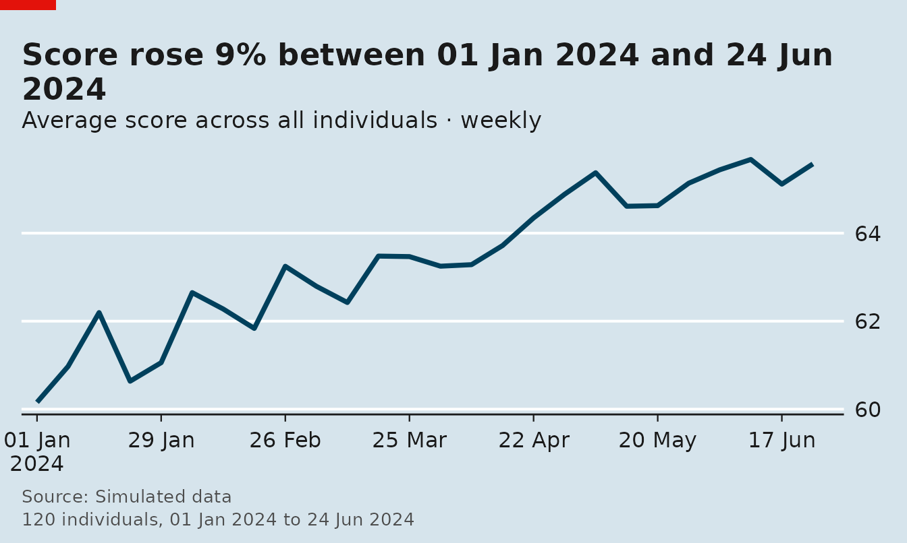

``` r

panel_line(panel, "score", by = "team")
```

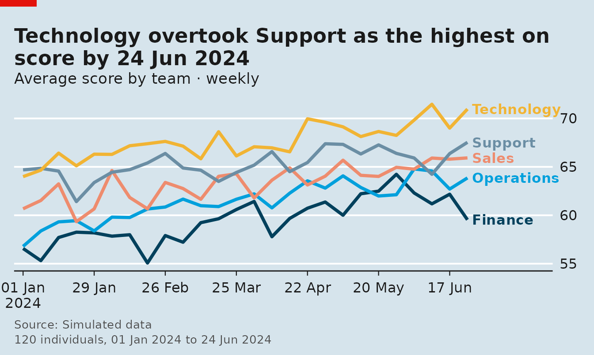

Coarsen time with `period`, add a privacy floor with `min_n`, or
highlight one group and index every group to 100 at its first period:

``` r

panel_line(panel, "score", by = "team", period = "month", min_n = 25)
```

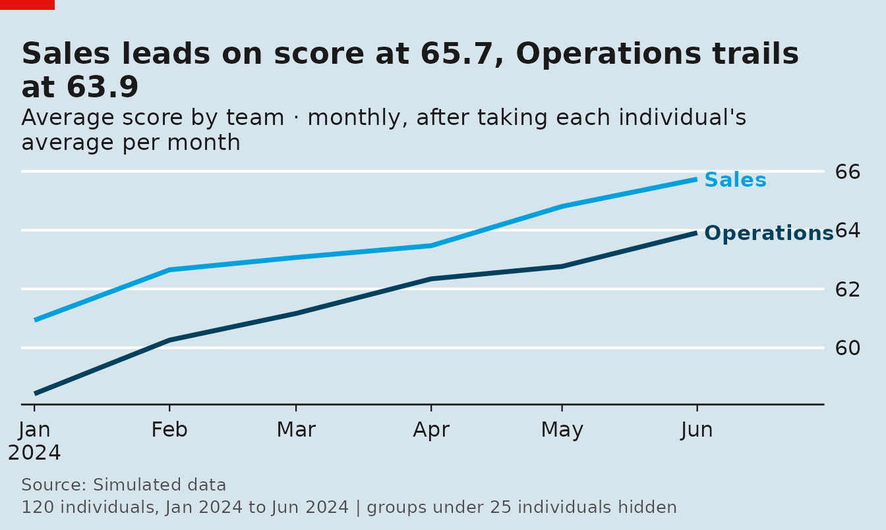

``` r

panel_line(panel, "score", by = "team", highlight = "Technology", index = TRUE)
```

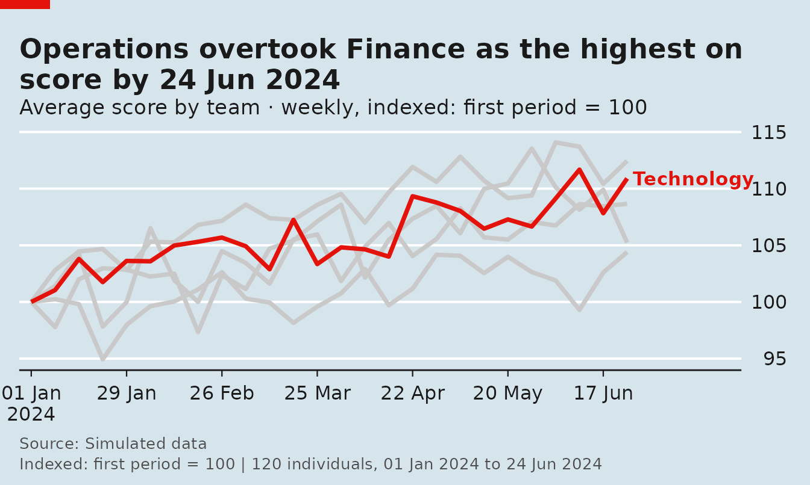

### Heatmap

Groups (rows) by time (columns), sorted by level:

``` r

panel_heatmap(panel, "score", by = "team", period = "week")
```

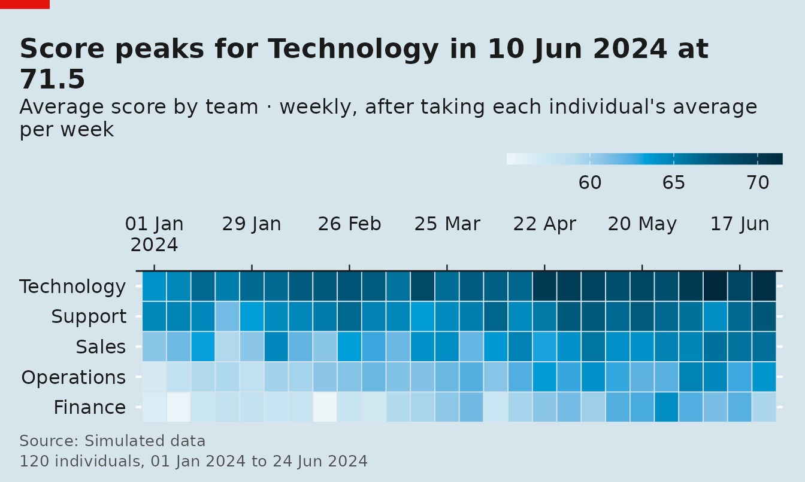

### Band

The median line with a shaded percentile band shows the spread across
individuals, not just the centre:

``` r

panel_band(panel, "score", by = "team", lower = "p10", upper = "p90")
```

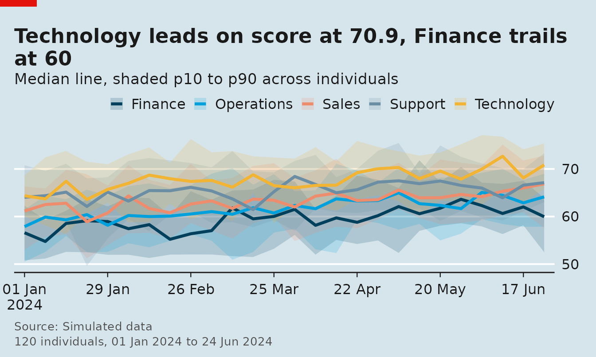

### Bars

Time is collapsed (`period = "all"` by default) and groups are ranked:

``` r

panel_bar(panel, "score", by = "team", fun_group = "median")
```

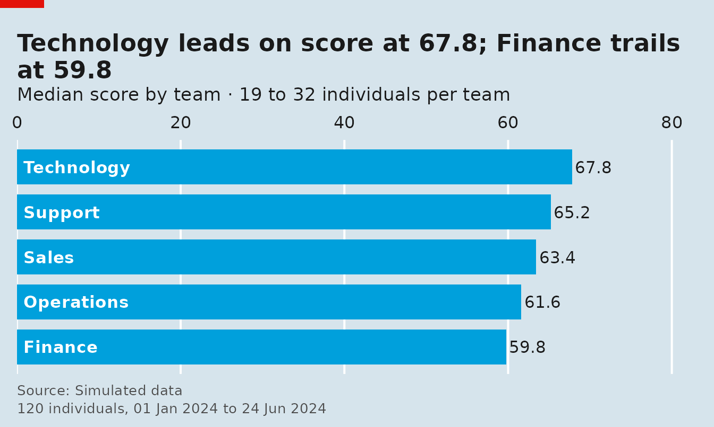

### Distribution

Each individual’s average over time, then the distribution across
individuals:

``` r

panel_distribution(panel, "score", by = "team")
```

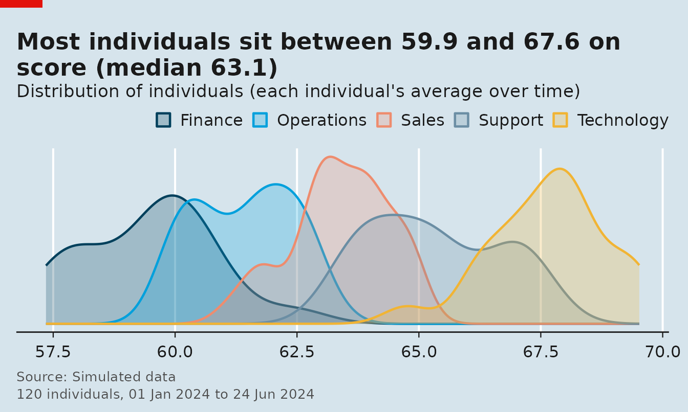

### Spaghetti

Thin lines for a random sample of individuals with the group average on
top:

``` r

panel_spaghetti(panel, "score", n_ids = 40, seed = 1)
```

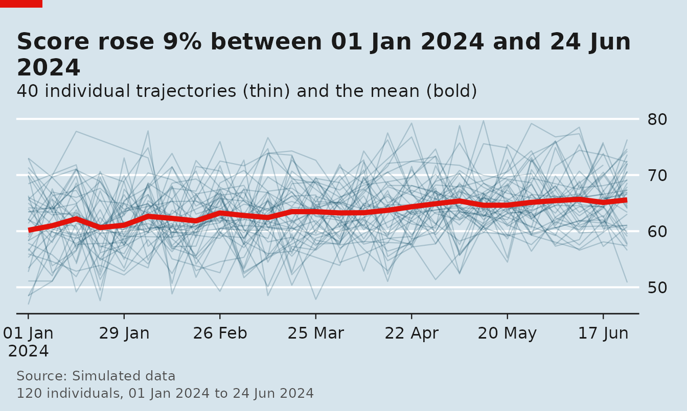

## Get the numbers behind a chart

Every chart takes `return = "table"` and returns exactly what it drew —
a tibble with the aggregated values, the period, the number of
individuals and the group:

``` r

head(panel_line(panel, "score", by = "team", return = "table"), 8)
#> # A tibble: 8 × 5
#>   .period    team    score    .n .group 
#>   <date>     <chr>   <dbl> <int> <chr>  
#> 1 2024-01-01 Finance  56.6    19 Finance
#> 2 2024-01-08 Finance  55.3    17 Finance
#> 3 2024-01-15 Finance  57.7    18 Finance
#> 4 2024-01-22 Finance  58.3    16 Finance
#> 5 2024-01-29 Finance  58.2    18 Finance
#> 6 2024-02-05 Finance  57.8    17 Finance
#> 7 2024-02-12 Finance  58.0    17 Finance
#> 8 2024-02-19 Finance  55.1    17 Finance
```

## Styles, tags and overrides

Five looks ship with the package, and any computed text can be
overridden:

``` r

panel_styles()
#> [1] "economist" "ft"        "clean"     "dark"      "mono"
```

``` r

panel_line(
  panel, "score", by = "team",
  style = "ft", tag = 1,
  title = "Scores rose across every team",
  source = "Simulated data"
)
```

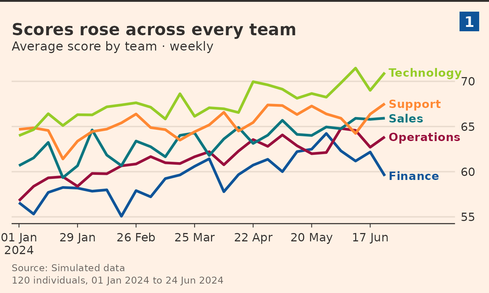

`use_panel_style("dark")` sets the default for the whole session.

## Numbered multi-panel figures

[`panel_figure()`](https://advancedpeopleanalytics.github.io/panelviz/reference/panel_figure.md)
lays several charts out under one headline, numbers the panels and
shares one source and notes footer:

``` r

panel_figure(
  list(
    panel_line(panel, "score", by = "team"),
    panel_heatmap(panel, "score", by = "team"),
    panel_bar(panel, "score", by = "team", fun_group = "median"),
    panel_distribution(panel, "score", by = "team")
  ),
  title = "Four views of one panel",
  subtitle = "Weekly scores by team, 120 simulated employees",
  source = "Simulated data",
  notes = "Individuals are simulated employees."
)
```

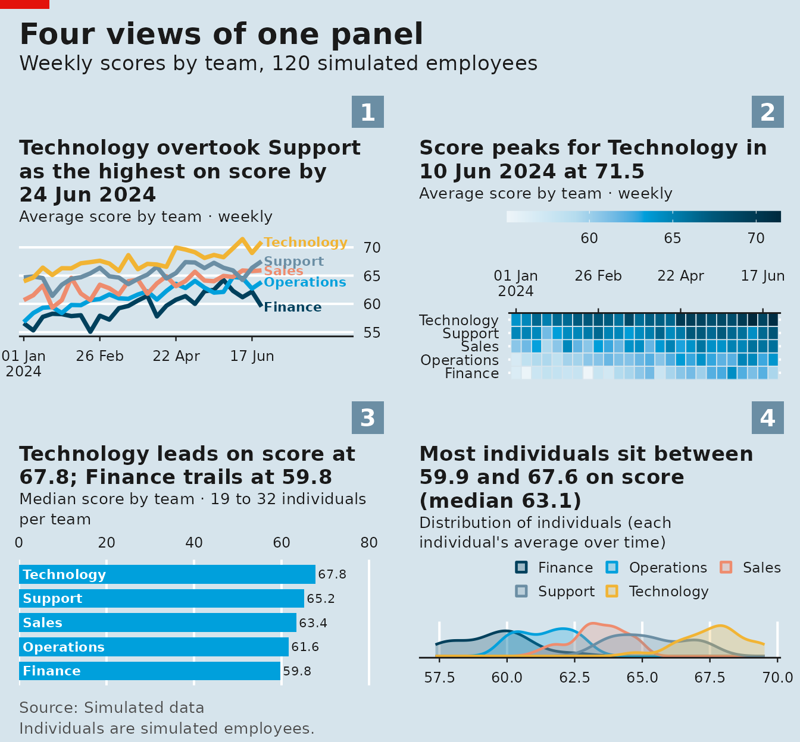

Save any chart or figure with
`save_panel(fig, "figure.png", width = 12, height = 8)`.

## Reading real data

[`read_panel()`](https://advancedpeopleanalytics.github.io/panelviz/reference/read_panel.md)
declares a file or URL as a panel — csv, tsv, Stata, SPSS and rds are
supported, and Stata variable labels become chart names:

``` r

nls <- read_panel("nlswork.dta", id = idcode, time = year)
gm  <- read_panel("gapminder.csv", id = country, time = year)

# composite individual: several columns
tour <- read_panel("tourism.csv", id = c(Region, State, Purpose), time = Quarter)
```

Wide data (one column per period) is pivoted to long format first:

``` r

as_panel_wide(wide, id = company, cols = starts_with("inc"))
```

## Where next

- [`?read_panel`](https://advancedpeopleanalytics.github.io/panelviz/reference/read_panel.md),
  [`?panel_aggregate`](https://advancedpeopleanalytics.github.io/panelviz/reference/panel_aggregate.md)
  and
  [`?panel_line`](https://advancedpeopleanalytics.github.io/panelviz/reference/panel_line.md)
  document the arguments shared by every chart.
- [`panel_styles()`](https://advancedpeopleanalytics.github.io/panelviz/reference/panel_styles.md)
  lists the five looks;
  [`save_panel()`](https://advancedpeopleanalytics.github.io/panelviz/reference/save_panel.md)
  writes PNG, PDF or PostScript at a chosen size.
- The README has a longer gallery of examples, including tracking
  charts, stacked bars and small multiples.
